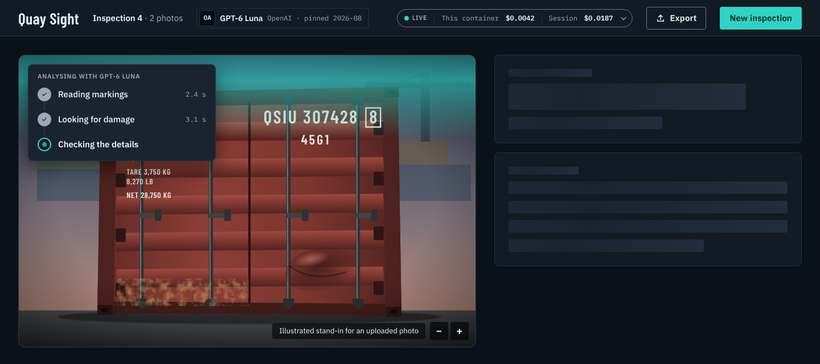
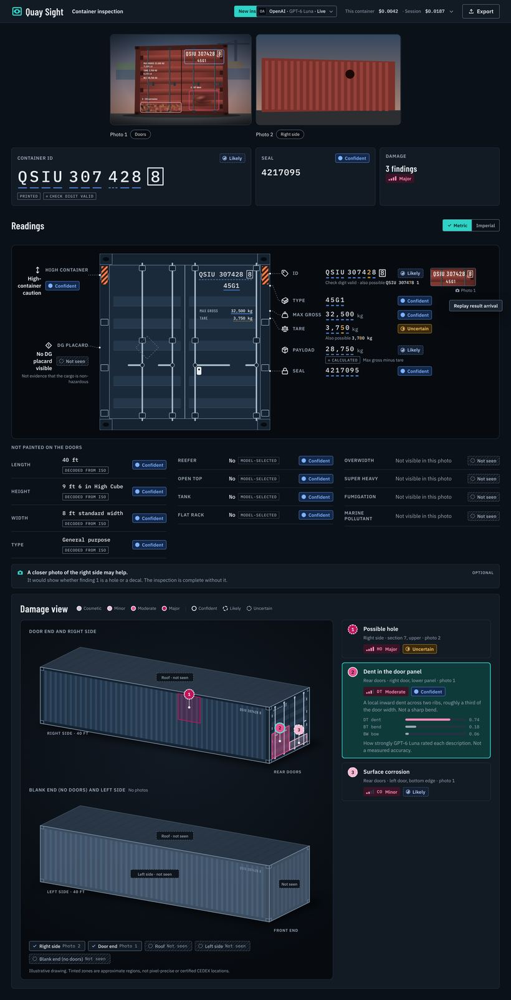

Quay Sight inspects photographs of freight containers. It reads the ID and markings, finds suspected damage, and says plainly how sure it is. The interface is a live stage demo for a projected room: the photograph is the hero, every reading carries its evidence, and nothing ever asks the audience to confirm, correct or choose. Design for **honesty at a glance**.

## The main screen

What the app looks like after photos are uploaded. Live, animated versions are in the **Components** view, group **Screens**: `AnalysingScreen` (results pending) and `ResultsScreen` (results landed; press *Replay result arrival* to watch them come in).

**While analysing**: the photo straight away, plain stages, skeletons. No percentages.

**Results back**: the photos in a strip across the top, then the key-facts tiles (`KeyFactTile`: Container ID, Seal, Damage and, when one is seen, Placards); then the readings (`ReadingsLedger`: the rear doors drawn flat as a `DoorFace`, each reading level with where it is painted, character by character, beside the crop it was read from); then the damage view across the full width.

## Principles

1. **The photo leads.** The uploaded photograph and the neutral schematic take the most space. Chrome stays quiet: `bg`, `surface`, hairline `line`.
2. **Three axes, never mixed.** *Certainty* (blue → amber → slate discs), *damage severity* (magenta, 1–4 bars on a five-level scale) and *hazard markings* (orange diamond) each have their own colour, glyph and component. A reader can always tell "we're unsure" from "this looks bad" from "a DG placard is visible".
3. **No green.** Green reads as *safe*, *clear* or *passed*, and Quay Sight never claims any of those. Nothing in the palette is green, and nothing uses the `brand` colour to mean a status.
4. **Absence is not a result.** Unphotographed faces are hatched and labelled *Not seen*. Missing probabilities are *unavailable*, never 0 or 100%.
5. **Read-only.** Results are observations and estimates. No edit icons, pickers, confirm buttons or "review required" banners.

## Content fundamentals

- **Voice.** Plain, calm British English: *analysed*, *colour*, *recognise*. The app describes the evidence rather than speaking as "we": "Visible check digit read independently."
- **Status words are fixed and everyday.** Use exactly **Confident** (clearly visible, everything checks out), **Likely** (probably right), **Uncertain** (could be one of a few things), **Can't tell** (in the photo, not clear enough) and **Not seen** (not in any photo). Never *supported*, *established*, *confirmed*, *certified*, *verified*, *safe*, *undamaged* or *user review required*.
- **Explain unresolved items in two beats.** "**Best interpretation:** 3,750 kg. **What remains uncertain:** the last digits are hard to read; it could be 3,780 kg."
- **Suggestions are optional.** "A closer photo of the top-left door markings may help." Never "Upload a photo to continue."
- **The manifest retry is an offer, not a task.** "Container ID not identified. If you have the manifest, paste the container numbers and check again." Never ask the presenter to fix, confirm or enter the number.
- **Caveat what isn't known.** "No DG placard visible", never "Non-hazardous". "Apparent moderate dent", never "Repair required". "Approximate area", never a precise position.
- **Show outcomes, not machinery.** Never mention passes, refinement, candidates, questions or retries. Progress reads *Reading the ID*, *Reading container details*, *Checking for damage*; each stage advances when its own requests settle. A doubtful reading shows its best value, its certainty and any plausible alternative ("Also possible: QSIU 307478 1"). That detail belongs in the exported JSON, not on screen.
- **Samples are explained, not jargon.** Visitors without a key choose **Enter as demo user** under the `SetupCard`. Demo mode offers the bundled **sample containers** that have a recording (two today), each with the **saved result** recorded from that photo ("works offline, no API key, no charge"), under a `DemoBanner` that stays on screen: *DEMO — sample results, not a real inspection*, a line saying that inspecting your own photos needs an API provider, and **Connect a provider**. There is no photo upload in demo mode. Once a sample is open, label it "Recorded demonstration: [provider/model]" (e.g. "Recorded demonstration: GPT-6 Luna / gpt-6-luna") and say what that means in one sentence.
- **Casing.** Sentence case for headings and buttons. UPPERCASE `label` style only for field names, echoing the door markings (MAX GROSS, TARE). No emoji, no exclamation marks.
- **Numbers.** Set IDs, codes, weights and money in mono. Group thousands: `32,500 kg`. Weights show in one unit system at a time, as the `UnitsToggle` says (`32,500 kg` or `71,650 lb`; `33.2 m³` or `1,173 cu ft`). Show sub-cent costs to four decimals: `$0.0016`, never `$0.00`. Unknown cost is *Cost unavailable*, not zero.

## Visual foundations

### Colour
- **Themes.** `Daylight` (light) is the default. `Night quay` (dark) suits darkened event rooms and photo-heavy screens; the top bar's `ThemeToggle` switches between them. Every token is defined in both.
- **Grounds.** `bg` for the page, `surface` for panels, `surface-raised` for floating layers, `surface-sunken` for the photo stage and schematic well. Separate panels with `line` hairlines, and draw control edges with `line-strong` (3:1 or better everywhere).
- **Text.** `ink` for primary text and `ink-muted` for labels and captions. Both pass 4.5:1 on every ground in both themes.
- **Action.** `brand` (shipping navy in Daylight, signal teal in Night quay) is the only action colour: primary button, selected provider, active stage, links. Text on it is `on-brand`. Focus is a solid 2px `focus-ring` outline offset 2px, 3:1 or better on every surface.
- **Certainty.** Use `cert-{confident|likely|uncertain|unknown|unseen}-{fg|bg|line}` only through `CertaintyChip`, `ContainerId` underlines and schematic marker outlines. Confident and Likely share a blue hue and differ by glyph and fill. Uncertain is the only warm certainty colour. Not seen adds the `hatch` pattern.
- **Severity.** Five levels: none, cosmetic, minor, moderate, major. *None* is no finding. `sev-cosmetic` (the lightest, least saturated step), `sev-minor`, `sev-moderate` and `sev-major` fill pins, region tints and severity bars. A component the photo gives no severity for is *Not rated*, in neutral ink. `damage-fg` on `damage-bg` for codes and labels.
- **Container drawing.** The `schem-*` family lights the 3D drawing: `schem-top` lightest, `schem-side` (with `schem-side-rib`) in the middle, `schem-end` darkest, with `schem-rail` framing, `schem-detail` hardware and `schem-shadow` beneath. It stays neutral steel so the severity tints carry the colour.
- **Hazard.** `hazard-fg` on `hazard-bg`, only inside the diamond `MarkingBadge` for DG placards and safety markings.
- **Errors.** `error-fg` on `error-bg`, only for system failures, always with the octagon glyph.
- **Never by colour alone.** Every status pairs its colour with a glyph and a word. Every marker pairs its fill with an outline style and a number.

### Type
- **Display.** Barlow Condensed, echoing quay signage and stencilled door markings: `display-xl` for the empty state, `display-lg` for the result headline, `display-md` for panel and face titles.
- **Text.** IBM Plex Sans: `title`, `body` (16px, the projected-reading floor), `body-sm`, `label` (uppercase field names) and `caption` (caveats).
- **Data.** IBM Plex Mono: `id-xl` for the container ID, `data` for readings, `data-sm` for the cost ledger. Plex Mono's dotted zero keeps 0 and O apart. Never set an ID in another face.
- All three faces load from Google Fonts. `components/bundle.css` imports them.

### Space, radius, elevation
- **Spacing.** A 4px scale, `space-1` to `space-8`. Panels pad `space-5`, major regions sit `space-6` apart, presentation displays keep a `space-8` margin, phones a `space-4` gutter.
- **Radii.** Small, like steel: `radius-sm` for controls and chips, `radius-md` for panels, `radius-lg` for the photo and schematic wells, `radius-xs` for tags and the check-digit box. `radius-pill` is reserved for the cost indicator and stage dots.
- **Elevation.** Panels sit flat on borders. `shadow-raised` is only for floating layers: the cost ledger, marker popovers and the settings drawer.
- **Controls.** Heights are `control-sm` 32, `control-md` 40 and `control-lg` 52 (the Inspect button). Schematic markers are `marker` 28px.

### Motion
- Restrained and purposeful: `duration-fast` for hover and focus, `duration-base` for the cost panel, the provider list and chip changes, `duration-arrive` for results landing.
- **Results arrive in order of importance**, never all at once (see `ResultsScreen`):
  - Wrap the results in `.qs-arriving` while waiting: skeleton shimmer, a soft sweep over the photo, real stages only.
  - Swap to `.qs-arrived` when the response is parsed. Photo areas draw, ID characters settle with their underlines, readings rise (`qs-rise` with `--i` for order), probability bars grow, pins drop with one ripple, and the cost pill glows and counts to the real figure.
  - Stagger 40–180ms per item; the whole landing takes about 1.6s.
- The active stage dot pulses. Nothing else loops.
- Under `prefers-reduced-motion`, or with the app's `qs-reduced-motion` class, all of it drops to zero.
- Never animate a fake progress bar or a ticking cost meter.

### Layout
- **First visit.** Only the `SetupCard`, centred, under a top bar holding the brand and the crumb *Container inspection*, with *Enter as demo user* beneath it. After Continue, the inspection screen below. Until a photo is added, the `PhotoDrop` (or, in demo mode, the sample picker) spans the full width. In demo mode the `DemoBanner` sits under the top bar and the sample picker takes the place of the `PhotoDrop`.
- **Desktop.** See the `ResultsScreen` and `AnalysingScreen` cards in the Screens group. A top bar with the name, the `SettingsChip` (in demo mode, the `RunChip` naming who answered the recording instead), the quiet `CostIndicator` and `NewInspection`. Below it, the photo strip across the top, then the `KeyFactTile` row, then the `ReadingsLedger` (the `DoorFace` in the middle, the readings painted on each leaf beside it, evidence crops at the right edge, and `FieldRow`s for what is not painted on the doors), then any suggestion `Notice`, then the damage view across the full width. The damage view holds the `ContainerSchematic`'s two views (rear and right side, front and left side, roof greyed out) stacked, with the `FindingCard`s in a column beside them. On wide screens (1800px and up) the two views sit side by side and the cards form a row underneath. `AnalysingScreen` shows the screen while results are pending; it still has the earlier readings column and is to be brought in line with the ledger (the ledger's own *Reading* state is in `ReadingsLedger`).
- **Phone.** The same order, stacked. The top bar wraps: the name and *New inspection* on the first line, the chip and the cost line beneath. In demo mode the top bar scrolls away and only the `DemoBanner` stays stuck. The cost ledger opens as a bottom sheet over `scrim`.
- **States.** Every surface needs designed empty (`PhotoDrop`), in-progress (`StageProgress`), confident, uncertain, insufficient-evidence and error (`Notice`) states.

## Iconography

- The status and utility glyphs are part of this system. They are single-ink 16px masks in `components/bundle.css`, used as `<i class="qs-glyph qs-glyph--{name}">` and coloured by `currentColor`:
  - certainty: `confident`, `likely`, `uncertain`, `unknown`, `unseen` (a disc that fills as confidence rises)
  - meaning: `hazard` (diamond), `error` (octagon), `photo`, `recorded`, `list` (manifest), `check`, `cross`
  - utility: `chevron`, `eye`, `upload`
  - readings (outline drawings at the same weight, one per kind of reading in the `ReadingsLedger`): `tag` (container ID), `container` (size-type code), `weight` (max gross), `scale` (tare), `package` (payload), `cube` (cubic capacity), `padlock` (seal), `stamp` (approval plate), `document` (CSC plate), `length`, `height` (dimensions, high-container caution). The Container details rows add `width`, `boxtype` (type), `reefer`, `opentop`, `tank` and `flatrack`. They name the kind of reading only: never a status, and never coloured by certainty, severity or hazard.
- For any other UI icon, use an outline set at a 1.5px stroke on a 16 or 20px grid to match the glyphs. Lucide is the suggested match; it is not part of the source.
- No emoji, and no illustrations of damage on the schematic. The photos in the previews are illustrated stand-ins; in the app, the uploaded photo takes their place.
- **Logo.** The mark is the corner casting: a container's cast steel corner, its oval aperture read as an eye. Use `.qs-logo` (mask, `brand` by default) and `.qs-brand` for the mark beside the name in Barlow Condensed; the SVG files and their rules are in the **Logo** asset group. One colour only, never green.

## Using the components

The repository is a Vue 3 app, so components ship as framework-agnostic CSS classes (`qs-*`) in `components/bundle.css`, built on `tokens.css` custom properties. Wrap the app in `.qs-root`, then follow each component's guidelines: `Button`, `CertaintyChip`, `SeverityBadge`, `ProvenanceTag`, `FieldRow`, `ContainerId`, `MarkingBadge`, `FindingCard`, `ManifestRetry`, `ContainerSchematic`, `CostIndicator`, `ProviderSelect`, `SetupCard`, `SettingsChip`, `SettingsDrawer`, `DemoBanner`, `RunChip`, `PhotoDrop`, `StageProgress`, `Notice`, `NewInspection`, `DamageAssessment`, `UnitsToggle`, `KeyFactTile`, `SealCard`, `DoorFace`, `ReadingsLedger`, `PhotoViewer` (the one sanctioned full-screen layer), `Loupe`. `AnalysingScreen` and `ResultsScreen` show them assembled into the main screen, before and after the results land. Turn each into a Vue SFC that renders the documented markup. Don't re-colour them locally.

## Not synced

At `MrCull/QuaySight@cc7ec10` the repository is an unstyled create-vue scaffold: no CSS custom properties, fonts, logo, icons or components to extract. The favicon is the Vue default, not a Quay Sight mark. Every token, component and glyph here is authored new from `spec/original-spec-idea.md`. Components are CSS plus static markup previews; there is no `bundle.js`.

## In this repository

- `tokens.json` is the source for every token. `tokens.css` is generated from it: `python3 design-system/scripts/build-tokens.py design-system/tokens.json > design-system/tokens.css`. Never edit `tokens.css` by hand.
- In the app, import `design-system/tokens.css` then `design-system/components/bundle.css` once (in `src/main.ts`), and wrap the app in `.qs-root`. Daylight is the default theme; set `data-theme="dark"` on `<html>` for Night quay.
- Type styles are available as `.qs-type-{name}` classes (`display-lg`, `body`, `label` and so on) in `tokens.css`.
- Open any `components/<Name>/preview.html` directly in a browser to see the reference rendering.
- The **Logo** asset group lives in `design-system/assets/logo/` (SVG files and their rules). The app uses `public/favicon.svg`.
