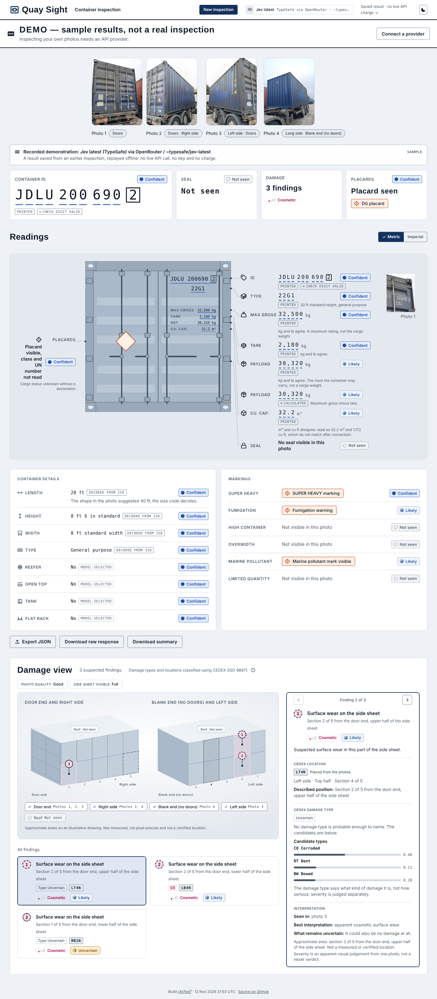

# Overview

## What it does

You give Quay Sight one to five photos of a single freight container. The app asks one AI model about the photos, checks the answers against container standards, and shows one combined result:

- **Container ID**, such as `JDLU 200690 2`. The app checks the ISO 6346 check digit and the owner code against a list of common BIC owner codes.
- **Size/type code** (for example `22G1`), decoded into plain words: "20 ft standard height, general purpose".
- **Length, height, width and type.** Length comes from the size code, or is estimated from the shape of a side photo.
- **Weights**: maximum gross, tare and payload, plus capacity. Payload is also calculated as gross minus tare.
- **Seal**: whether a seal is visible and its number, read character by character.
- **Placards**: the class and UN number of each dangerous-goods placard, and the marine pollutant and limited quantity marks.
- **Damage**: findings drawn on a flat, illustrative container schematic, using CEDEX damage types and locations.
- **Cost**: the estimated API cost for this container and for the session.

Each value carries one of five certainty words: **Confident**, **Likely**, **Uncertain**, **Can't tell**, **Not seen**. See [Reading the results](results-guide.md).

## What it is not

- It is not a certified condition survey, a safety inspection, a dangerous-goods declaration or a gate-release system.
- It never says a container is "safe", "sealed" or "verified". "No placard seen" does not mean the cargo is non-hazardous.
- An area that was not photographed is **Not seen**, never "clear".
- There are no accounts, no database and no backend. Nobody who runs the app sees your key or your photos.

## Principles

1. **The app does the reasoning.** You are never asked to type, choose or confirm an answer. The one exception is an optional manifest paste when the ID can't be read, and it never blocks a result.
2. **One model at a time.** An inspection is never run by two models, and results from two models are never mixed.
3. **Standards checks are done in code**, not by the model. The check-digit maths is deliberately kept out of the prompt.
4. **Honest about uncertainty.** Alternatives are shown as "Also possible", and the app doesn't pretend a model's probability is a calibrated one.
5. **Bounded spend.** A container inspection stops at 50 requests or $0.50, whichever comes first, and gives a partial result.

## Two ways to use it

| Mode | Needs | What happens |
| --- | --- | --- |
| **Live** | An API key for OpenRouter (to reach Jev) or for OpenAI (GPT-6 Luna) | Your photos go to that provider; the cost is real |
| **Demo** | Nothing | Bundled sample photos open a result recorded earlier; it works offline, with no key and no charge |

Demo results are clearly labelled "Recorded demonstration" and never pass as a live response.

## Providers

| Provider | Models | Reached through |
| --- | --- | --- |
| OpenRouter | Jev latest (recommended, a moving alias), Jev 1.14, Jev 1.13 | OpenRouter's Decisions endpoint |
| OpenAI | GPT-6 Luna | OpenAI's Decisions API, directly |

Jev is reached through OpenRouter because TypeSafe's own endpoint refuses browser cross-origin calls (see `docs/adr/0001-openrouter-no-typesafe-direct-no-relay.md`). Both providers speak a "Decisions" API: the app asks multiple-choice questions and the model answers with a probability for each option.
