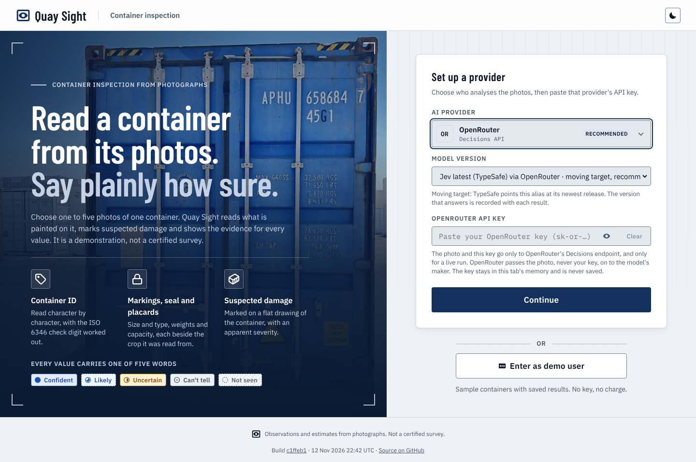
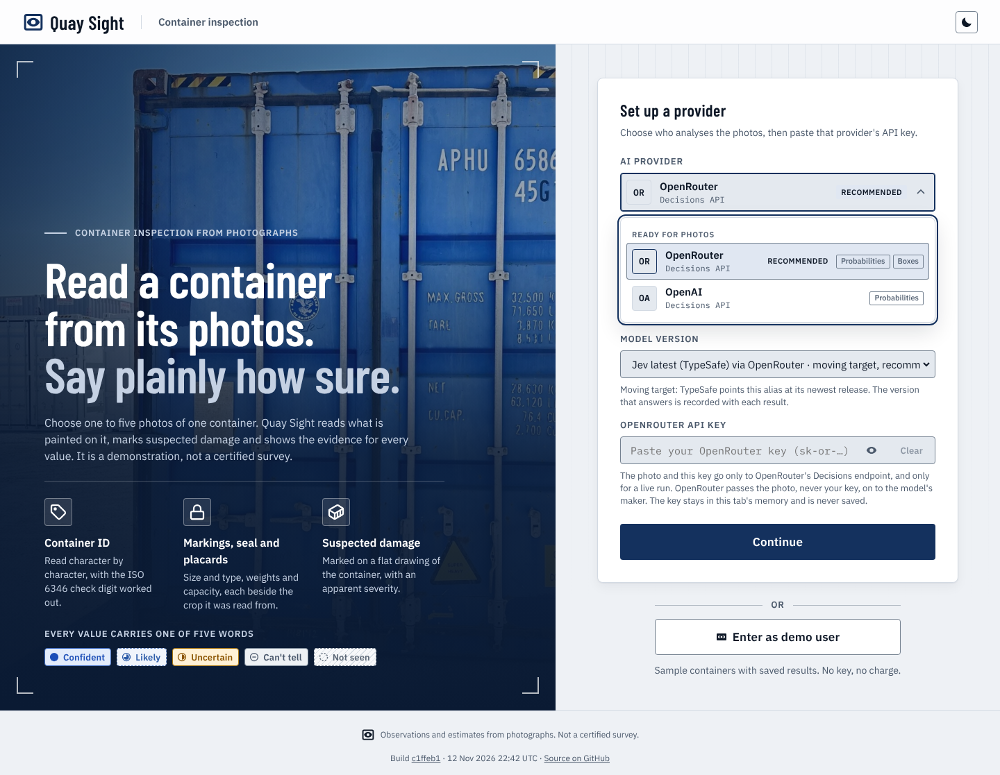
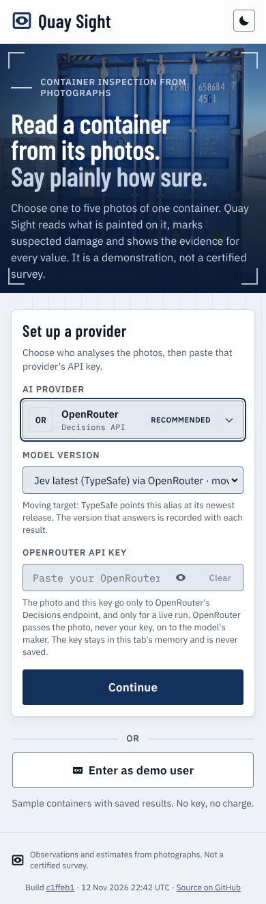
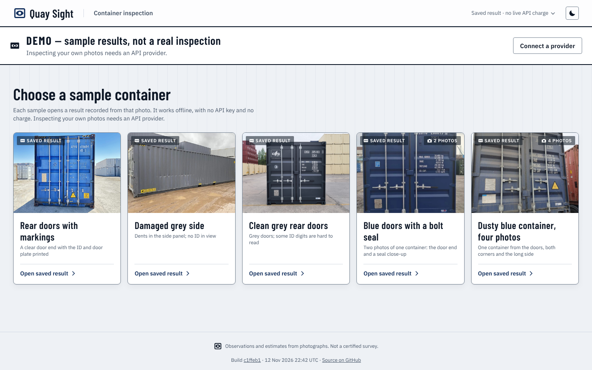
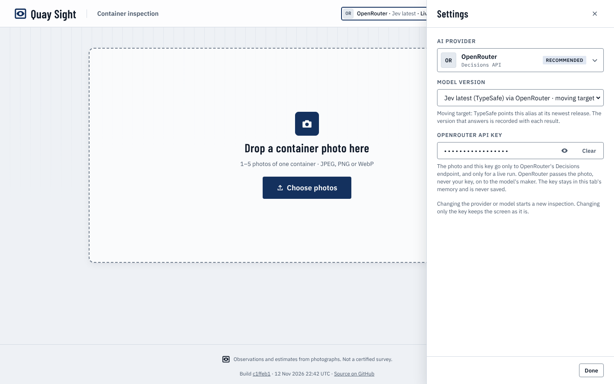
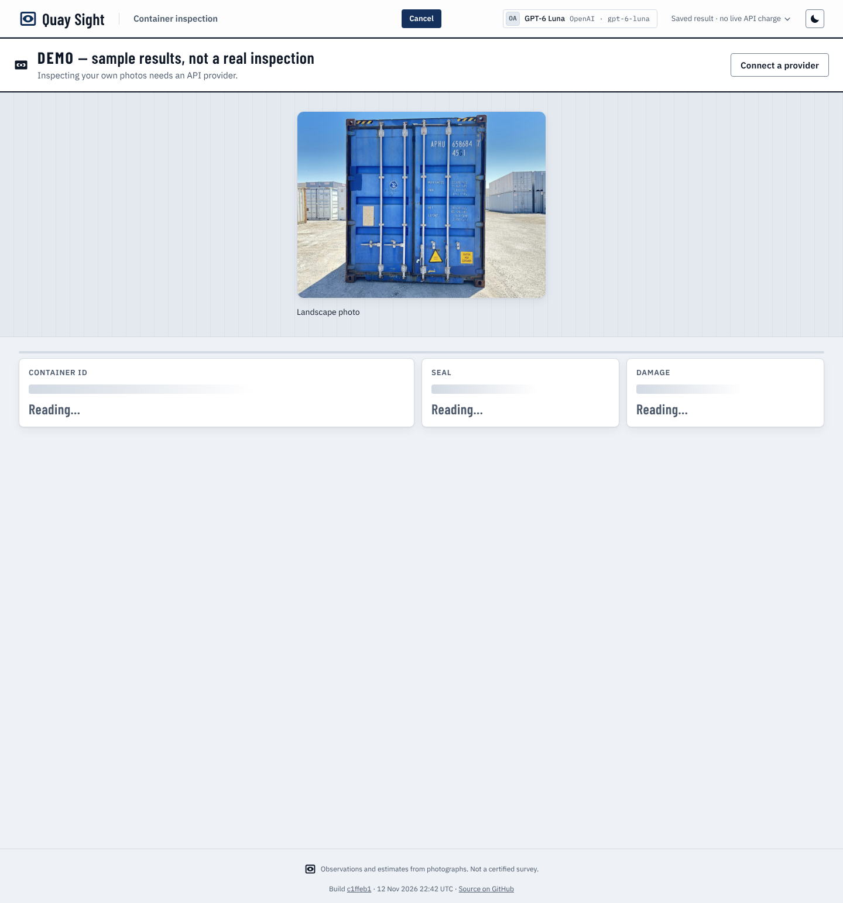
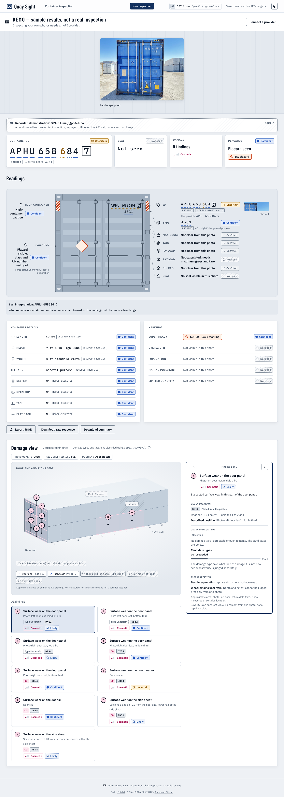
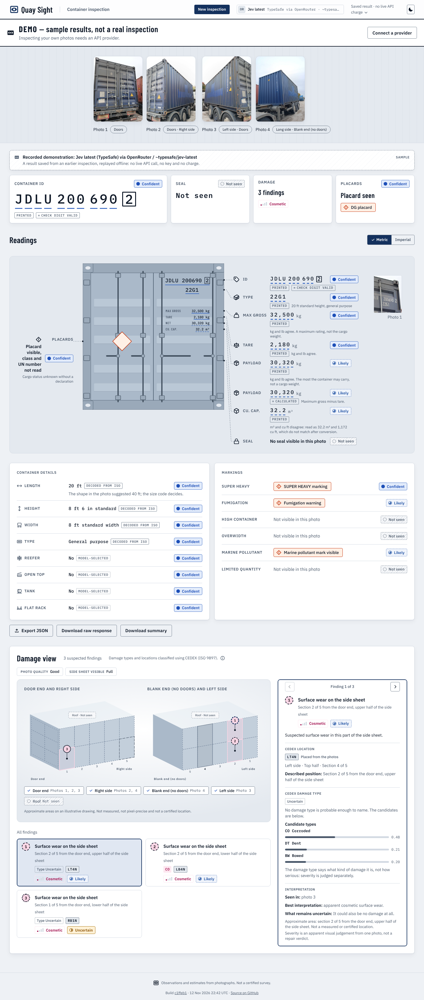
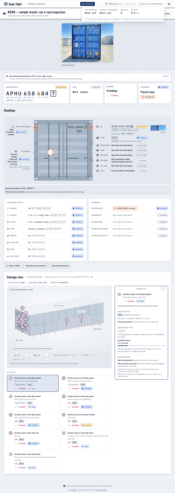
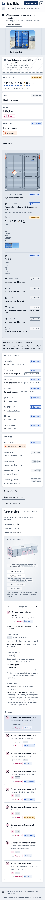

# User guide

## 1. Start the app

```sh
pnpm install
npm run dev
```

Open the address Vite prints. For a production build, use `npm run build` then `npm run preview`.

## 2. Choose live or demo



The first screen has a short introduction beside the **Set up a provider** card.

- **Live:** pick a provider and model, paste that provider's API key, and press **Continue**. OpenRouter with Jev latest is pre-selected. The key stays in this tab's memory only and is forgotten when you close or reload the page. Keys that don't start with the provider's usual prefix (`sk-or-` for OpenRouter) get a warning but are not refused.
- **Demo:** press **Enter as demo user** under the card. No key is needed.



On a phone the card works the same way:



## 3a. Demo mode: pick a sample



Each sample card opens a result recorded from that photo. They cover different cases: a clear door end with the ID and door plate, a damaged grey side, grey doors with some hard-to-read digits, blue doors with a bolt seal (two photos), and one container from four angles. Picking a sample starts the inspection.

## 3b. Live mode: choose photos



Drop or choose **1 to 5 photos of one container** (JPEG, PNG or WebP). Choose them all at once. A sixth photo is refused with a plain message. The inspection **starts as soon as the photos are chosen**; there is no Start button.

- The header chip shows the provider, model and mode. Click it to open **Settings**, where you can change provider, model or key.
- Changing provider or model starts a new inspection. Changing only the key keeps the screen as it is.
- If you choose photos before a key is saved, Settings opens and the inspection starts when you save the key.

## 4. Watch it run



The photo sits at the top with a soft scan sweep. Below it, the key-facts tiles read **Reading…** and fill in one at a time as each part arrives. The app shows no fake percentage, because the API gives no real one. A part that fails reads **No result**, never **Not seen**.

Press **Cancel** in the header to stop. This clears straight back to the empty picker with no confirmation. Money already spent stays in the session total.

## 5. Read the result



From the top:

1. **Photo strip**: each photo with a chip naming the face the model found (Doors, Left side, and so on). Hover for a loupe; click to enlarge.
2. **Key-facts tiles**: Container ID, Seal, Damage and, only when one is seen, Placards. Click a tile to jump to its detail.
3. **Readings**: a door-end drawing with each value labelled next to it, with its source (Printed, Decoded from ISO, Calculated, Model-selected) and its certainty. A **Metric / Imperial** switch changes units.
4. **Container details** and **Markings**: length, height, width, type, reefer, open top, tank, flat rack; super heavy, high container, overwidth, fumigation, marine pollutant, limited quantity.
5. **Export**: **Export JSON**, **Download raw response** and **Download summary**.
6. **Damage view**: see below.

[Reading the results](results-guide.md) explains each part in detail.

## 6. Damage view



Findings are drawn on two fixed 3D views of the container: **Door end and right side**, and **Blank end (no doors) and left side**. The roof is always greyed out. Select a finding, either from the list or by its numbered marker, to see its CEDEX location, candidate damage types, severity, the photo it was seen in and what remains uncertain. The drawing is illustrative and approximate: it is not measured and not a certified location.

## 7. Check the cost



The header's cost indicator shows this container's cost and the session total. Click it to expand the totals: containers, requests, tokens and API time. Each request is listed with its purpose, provider, exact model version, status, latency and cost. Costs are estimates, not an invoice. Demo results show **no live API charge**.

## 8. Start again

**New inspection** appears once there is something to clear. It returns to the empty picker. To inspect a different container, choose all its photos at once.

## On a phone



The layout reflows to one column with no horizontal scrolling. The damage view comes first in the lower section.

## Theme and motion

The header has a light/dark toggle. Under the system "reduce motion" setting, results appear without the arrival animation or scan sweep.

## If something fails

The app says why in plain words: provider busy, refused, unreadable reply, or offline. A failed inspection offers **Try again**, which reruns the same photos. If the container ID can't be read, an optional paste box accepts a manifest list (CSV, tab- or space-separated, or one ID per line, up to about 500). The retry is a separate paid run, replaces only the ID result and never blocks the first result.
